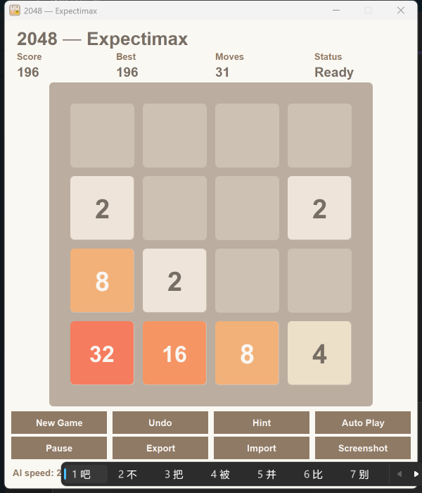

# TwoZeroFourEightGame

[](https://www.java.com)
[](https://maven.apache.org)
[](https://junit.org)
[](LICENSE)

A complete implementation of the game 2048 in Java Swing, driven by an Expectimax artificial
intelligence that wins from any randomized opening. The program has no runtime dependency beyond
the Java standard library, performs no network access, maintains no database, and writes nothing
to disk unless the player asks for it.



Repository: <https://github.com/richie-rich90454/TwoZeroFourEight>

Author: Richard Jiang

## Table of Contents

1. [Play](#play)
2. [Build and Run](#build-and-run)
3. [Architecture](#architecture)
4. [The Move Engine](#the-move-engine)
5. [The Evaluation Function](#the-evaluation-function)
6. [The Expectimax Search](#the-expectimax-search)
7. [The Transposition Table](#the-transposition-table)
8. [Why the Evaluator Commits to One Corner](#why-the-evaluator-commits-to-one-corner)
9. [Why the Cache Keys the Node Kind](#why-the-cache-keys-the-node-kind)
10. [Performance and Memory](#performance-and-memory)
11. [Threads](#threads)
12. [Save File Format](#save-file-format)
13. [Testing](#testing)
14. [Project Layout](#project-layout)
15. [Implementation Notes](#implementation-notes)
16. [License](#license)

## Play

Three modes of play share one live board, and the player may switch between them at any moment:

1. **Manual play.** The human plays every move from the opening board.
2. **Auto Play from the start.** The artificial intelligence drives every move until a 2048 tile
   appears or the board fills.
3. **Auto Play from mid game.** The human plays some moves, then hands the board over. Because
   every decision is computed from the current board rather than from a remembered plan, the
   handoff is instantaneous and always correct. Auto Play may be switched off at any time, and
   the human resumes on the same board. The AI speed slider sets the pause between autoplay
   moves, 100 ms at the fast end and 1000 ms at the slow end.

| Input | Effect |
|---|---|
| Arrow keys | Slide every tile toward that edge |
| `W` `A` `S` `D` | The same four moves |
| A drag of 25 pixels | A swipe in that direction, with a mouse or a touchscreen |
| **New Game** | Deal a fresh board with two tiles |
| **Undo** | Step back exactly one move, using a single snapshot |
| **Hint** | Ask the artificial intelligence for its move, without playing it |
| **Auto Play** | Give the board to the artificial intelligence, or take it back |
| **AI speed** | The pause between autoplay moves, 100 ms at the fast end to 1000 ms at the slow end |
| **Pause** | Refuse new moves and stop autoplay, without interrupting an animation |
| **Export** / **Import** | Save and load a plain text board, ending in `.txt` |
| **Screenshot** | Write the whole window to a timestamped PNG file |

A direction typed while the artificial intelligence is thinking is held in one slot and played as
soon as autoplay is switched off. A direction typed while the board is animating is ignored,
because the board has already committed to a move.

Reaching a tile worth 2048 ends the game with **You win!** and offers Continue, which carries on
past 2048. A board with no legal move is a real game over. The game is never abandoned for any
other reason: there is no heuristic that declares a position hopeless, because such a heuristic
cannot be both sound and complete, and a false declaration is worse than continuing. Nothing is
saved between sessions. There is no high score on disk and no settings file, by design.

## Build and Run

The build requires Maven and any Java Development Kit that supports Java 8 or later. The
production build targets Java 8 bytecode.

```
mvn -q clean package
java -jar target/TwoZeroFourEightGame-1.0.0.jar
```

The test suite is JUnit 5 and runs with:

```
mvn -q test
```

`run.sh` and `run.bat` wrap the two build and launch commands. There is no continuous
integration configuration. The build is plain Maven, and the tests run locally.

Optional memory flags, useful to bound the heap of this small program:

```
java -Xms64m -Xmx256m -XX:+UseSerialGC -jar target/TwoZeroFourEightGame-1.0.0.jar
```

## Architecture

The program separates the model, the search, the view, and the control of each move. The
controller is the only class that is allowed to change a game in progress.

```
src/main/java/org/twozerofoureightgame
├── Main.java                     Start the event thread and build the controller
├── model                         Board, Direction, GameState, MoveResult, TileTransition
├── ai                            PackedBoardUtility, RowMoveTable, AIWeights,
│                                 HeuristicEvaluator, TranspositionTable, ExpectimaxAI
├── view                          GameFrame, BoardPanel, TileView, HeaderPanel,
│                                 ControlPanel, OverlayPanel, Theme
├── controller                    GameController, KeyboardHandler, GestureHandler
├── io                            StateExporter, StateImporter, ScreenshotUtility
└── utility                       AnimationManager, Animation, Easing,
                                  RandomUtility, IconLoader
src/main/resources/icons          The favicon in SVG, seven PNG sizes, and ICO
```

The controller owns the board, the score, the undo snapshot, the artificial intelligence, and the
window. Every mode, every input, and every ending is decided there.

## The Move Engine

### Representation

Each cell stores a small exponent rather than the tile value. An exponent of zero means the cell
is empty, an exponent of one means a tile worth 2, and an exponent of eleven means a tile worth
2048. Merging two tiles is therefore a single addition of one. The model keeps the board flat, as
`byte[16]`, which occupies about 32 bytes, against roughly 160 bytes for an `int[4][4]` with its
four object headers. The search packs the whole board into one `long`, four bits per cell,
sixteen cells in sixty four bits. The empty cell count and the largest exponent are maintained
incrementally, so neither question ever requires a scan.

### Row Tables

A row holds four exponents and therefore fits in sixteen bits. There are 65,536 possible rows,
so the program precomputes every answer once, at startup, in two tables:

* `LEFT_TABLE[pattern]` holds the row that results from sliding left.
* `RIGHT_TABLE[pattern]` holds the row that results from sliding right.

Each entry is one `int`: bits 0 through 15 hold the resulting row, and bits 16 through 31 hold
the score the row earned. Whether the row changed is not stored, because a slide moved something
exactly when the resulting pattern differs from the original, and comparing two numbers is free.
The two tables occupy about 650 KB. Up and down reuse the same tables: transpose the board so
that columns become rows, apply the horizontal table, and transpose back.

Pseudocode for building one table entry (leftward; the rightward table mirrors it):

```
buildLeftOutcome(pattern):
    tiles = the nonzero exponents of pattern, left to right
    write = 0
    score = 0
    read = 0
    while read < length(tiles):
        if read + 1 < length(tiles) and tiles[read] == tiles[read + 1]:
            merged = tiles[read] + 1
            place merged at write
            score = score + 2 ^ merged
            write = write + 1
            read = read + 2              # a merge consumes both tiles
        else:
            place tiles[read] at write
            write = write + 1
            read = read + 1
    return (new row) OR (score shifted left by sixteen bits)
```

Pseudocode for applying a direction to a packed board:

```
applyPacked(packed, direction):
    if direction is horizontal:
        source = packed
    else:
        source = transpose(packed)
    result = 0
    for row in 0 .. 3:
        pattern = bits (row*16) .. (row*16 + 15) of source
        if direction is LEFT or UP:
            result row = new pattern of LEFT_TABLE[pattern]
        else:
            result row = new pattern of RIGHT_TABLE[pattern]
    if direction is horizontal:
        return result
    else:
        return transpose(result)
```

Applying a move is therefore four table reads. Legality is four pattern comparisons. Both are
constant time, and neither allocates.

The transpose swaps the six off diagonal nibble pairs of a four by four grid (cells 1 and 4, 2
and 8, 3 and 12, 6 and 9, 7 and 13, 11 and 14), each by isolating the difference of the pair with
an exclusive or and writing the difference into both places.

## The Evaluation Function

`HeuristicEvaluator` scores a board in a single pass over sixteen cells. The score is the sum of
six features whose weights live together in `AIWeights`:

| Feature | Weight | Meaning |
|---|---|---|
| Empty cells | 270 each | Free space, the strongest signal that a game survives |
| Monotonicity | 47 per unit of disorder | Rows and columns prefer to be ordered, in either direction |
| Smoothness | -10 per unit of difference | Neighbors prefer similar values, so they merge soon |
| Corner control | 100 per exponent step | The largest tile earns credit for sitting in a corner |
| Merge potential | 50 per pair | Each pair of equal neighbors can become a merge |
| Snake pattern | 150 times the snake sum | The tiles prefer one fixed snake order |

Pseudocode for the snake term:

```
SNAKE = [12, 13, 14, 15, 11, 10, 9, 8, 4, 5, 6, 7, 3, 2, 1, 0]
snakeSum = 0
for rank in 0 .. 15:
    snakeSum = snakeSum + exponent(cell SNAKE[rank]) * (rank + 1)
contribution = snakeSum * 150
```

The snake visits the board in a boustrophedon path starting in the bottom left corner and climbing
upward. Its rank weights climb gently, by one per rank, so the term expresses an ordering of the
tiles rather than a single preferred cell. The four corners still earn a separate credit through
the corner term. The section below explains why the snake commits to one corner instead of
choosing among all eight rotations.

## The Expectimax Search

The search alternates between two kinds of node. A player node is a move the human would make,
and it takes the best of its children. A chance node is the random tile the game drops afterward,
and it averages its children, weighting a new 2 tile at nine tenths and a new 4 tile at one
tenth. There is no opponent. The value of a position is simply how promising it looks, as measured
by the evaluation function.

* A position that already holds a 2048 tile is worth `TERMINAL_WIN_VALUE` (10^9).
* A position with no legal move is worth `TERMINAL_LOSS_VALUE` (-10^9).
* Any other position at depth zero is worth the heuristic.

The depth is not fixed. The search starts at depth 2 and goes one level deeper each round, and it
keeps the answer from the last round that finished before the time budget, which defaults to 100
milliseconds, ran out. The answer is therefore always delivered on time, and it is never worse
than the previous, shallower round. Within a round, the move that scored best last round is tried
first, so the transposition table warms up quickly. Moves tied within one point of the best are
broken uniformly at random, which keeps repeated games from looking identical. Only one search
may run at a time.

Pseudocode, with `d` the remaining depth and `P` the player node flag:

```
expectimax(board, d, P):
    if largest tile on board is 2048: return WIN
    if d == 0: return evaluate(board)
    entry = cache.lookup(board, d, kind(P))
    if entry exists: return entry
    if P is true:                                  # a move
        value = -infinity
        moved = false
        for direction in [LEFT, RIGHT, UP, DOWN]:
            child = applyPacked(board, direction)
            if child == board: continue            # illegal move
            moved = true
            value = max(value, expectimax(child, d - 1, false))
            if value >= WIN: break                 # a win is a win
        if not moved: value = LOSS
    else:                                          # a random drop
        empty = the empty cells of board
        if empty is empty: value = expectimax(board, d - 1, true)
        else:
            total = 0
            for cell in empty:
                total = total + 0.9 * expectimax(board + 2 at cell, d - 1, true) / |empty|
                total = total + 0.1 * expectimax(board + 4 at cell, d - 1, true) / |empty|
            value = round(total)
    cache.store(board, d, kind(P), value)
    return value

chooseBestMove(cells, budget):
    deadline = now + budget
    best = first legal direction
    order = directions sorted by heuristic of their children
    for depth in 2 .. 8:
        evaluate the four moves in order, by expectimax
        if the budget expired: break, and keep the previous best
        if a move reaches WIN: return it
        best = random choice among moves within one point of the top
        order = best move first, then the rest by value
    return best
```

From randomized two tile openings the search reaches 2048 consistently in about one thousand
moves at a 40 millisecond budget. The regression test `theArtificialIntelligenceActuallyGrows
ARandomizedOpening` plays 120 real moves with spawns and asserts that the largest tile is past
the 32 tile, which pins this behavior.

## The Transposition Table

Visited boards are cached in three parallel primitive arrays, not a hash map: `long[]` keys,
`int[]` values, and `byte[]` metadata, 131,072 slots, about 1.6 MB, with zero per entry object
overhead. A lookup costs one multiply, one shift, and three array reads, with no pointer
chasing. Each slot stores the full sixty four bit board as its key, so collisions between
different boards are detected by comparing keys rather than by trusting the hash. The metadata
byte packs the occupied bit, four bits of remaining depth, and the node kind. A value is returned
only when it was computed at the same depth or deeper than the caller needs, because a shallower
value would be optimistic, and only when its node kind matches. The next section explains why the
kind is part of the identity.

## Why the Evaluator Commits to One Corner

An earlier version of the evaluator took the best of all eight rotations and reflections of the
snake, which made the score of a board identical under every rotation. On a sparse board this made
UP score exactly the same as DOWN, and LEFT exactly the same as RIGHT. The search then had pairs
of equally good moves that undid one another, and it played them for as long as the clock
allowed, never merging anything: 6000 moves in 246 milliseconds, score zero, largest tile 4.
A measurement confirmed the tie digit for digit. Symmetry invariance cannot express the idea of
building somewhere on purpose, so the symmetry was deliberately given up in favor of one fixed
path that climbs toward the bottom left corner. The test
`turningTheBoardChangesTheScoreBecauseTheEvaluatorPrefersOneCorner` pins this property, and the
comment on `HeuristicEvaluator` records the reason.

## Why the Cache Keys the Node Kind

The value of a position depends on whether the position is expanded as a player node or as a
chance node, because the maximum over moves and the average over spawns are different numbers.
An earlier version of the cache keyed on board and depth only, so a chance node value could be
served back for a player node request. The search then returned moves it had not evaluated, and
an independent replication of the same expectimax disagreed with the program, favoring a move
worth 6,485,525 while the program chose one worth 778,437. The fix stores the node kind in the
metadata byte and refuses entries whose kind differs. The test `theSearchNeverFailsOn
DegenerateBoards` and the fuzz check that a chance value is never handed to a player node and
that a player value is never handed to a chance node.

## Performance and Memory

| Operation | Complexity | Mechanism |
|---|---|---|
| `Board.applyMove` | Constant | Four row table reads, then pack and unpack |
| `Board.isGameOver` | Constant | Four pattern comparisons |
| `HeuristicEvaluator.evaluate` | Constant | One pass over sixteen cells |
| Chance iteration | Constant | Bit operations over the empty cell mask |
| Transposition lookup | Constant amortized | One multiply, one shift, three array reads |
| Row move precompute | 65,536 patterns, once | 650 KB total |
| Snake precompute | Constant | Sixteen weights |
| Undo | Constant | One sixteen byte snapshot |
| Steady state processor use | Near zero | The animation timer stops when idle |
| Per frame allocation | Zero | Pooled animations, cached paint objects |

Steady state memory is roughly 5 MB: 650 KB of row tables, about 1.6 MB of transposition cache,
and the interface. Painting creates no objects. Colors, fonts, tile text, composite rules, and the
rendering hints are built once in `Theme`, and the tile values are precomputed rather than
formatted on the fly. The cell size is worked out from the panel size on every layout pass,
between 48 and 100 pixels, so the board is centered in whatever room the window gives it and
nothing can be clipped on any platform.

## Threads

| Thread | Responsibility |
|---|---|
| Event dispatch thread | All rendering, input, and animation, as Swing requires |
| One background worker at a time | The hint and the autoplay computation |
| Main | Starts the event thread and does nothing else |

Results come back on the event thread, and a repaint is never called from a background thread. A
stale answer is guarded: switching the game off cancels the in flight worker, the autoplay
cadence reschedules instead of stalling when the worker is busy, and the probe generation counter
discards answers that arrived after the board moved on.

## Save File Format

Plain UTF-8 text, one `name=value` per line, ending in `.txt`. Tile values are written the way a
player reads them rather than as exponents, so that a saved file makes sense to somebody who has
never seen the source code:

```
version=1
score=1234
moves=42
won=false
lost=false
board=2,0,4,0,0,0,0,0,16,0,0,8,0,4,0,0
```

On the way back in, the version number must match, the board line must hold exactly sixteen
entries, and every entry must be zero or a power of two that fits in a cell. Anything else raises
an error, and the controller reports a single clear message, **Invalid save file.**, instead of
loading a broken board. Export uses the file name the player chose and appends `.txt` when it is
missing. Screenshots are PNG files named `2048-screenshot-yyyyMMdd-HHmmss.png`. The manual
screenshot captures the whole window as it appears on screen, falling back to painting the window
when no display can be read. Reaching 2048 writes one such picture automatically, before the win
overlay appears, and without asking.

## Testing

```
mvn -q test
```

Six test classes, written to read like specifications. Selected highlights:

* `BoardTest` checks the slide and merge rules, the score, the game over condition, packed round
  trips, and an invariant that runs 500 random moves: the recorded tile journeys always rebuild
  exactly the board the model produced, and every merge aims two merged transitions at one cell,
  which is the pairing the view relies on to swell the survivor and recycle the other.
* `RowMoveTableTest` checks the tables against a naive reference implementation over several
  thousand random patterns and every small pattern.
* `HeuristicEvaluatorTest` checks the directional properties of the evaluator, including the fact
  that turning a board changes its score, and that two equal neighbors are worth more than the
  same tiles kept apart.
* `ExpectimaxAITest` checks that a fixed seed always gives the same move, that a crowded board
  still gets a legal move, that a finished board gets none, that the time budget is honored, that
  degenerate boards (empty, single tile, every tile equal) cause no failure, and that 120 real
  moves with spawns grow a randomized opening comfortably past the 32 tile.
* `GameStateTest` checks that a snapshot keeps its values after the board moves on.
* `StateExporterTest` checks round trips and four kinds of malformed file.

Beyond the suite, two harnesses verify what the suite cannot see. A fuzzer compares 69,499 moves
across 20,000 random boards against an independently written statement of the 2048 rule,
covering the resulting board, the score, legality, game over, counters, transpose, undo, round
trips, and the search on every board. A view check renders the same board twice, once by
rebuilding it from the model and once by playing the animated move, and requires the pictures to
match pixel for pixel; a negative control proves the check detects a real difference.

## Project Layout

```
TwoZeroFourEightGame/
├── pom.xml
├── README.md
├── LICENSE
├── preview.png
├── run.sh
├── run.bat
└── src
    ├── main
    │   ├── java
    │   │   └── org/twozerofoureightgame
    │   │       ├── Main.java
    │   │       ├── model
    │   │       │   ├── Board.java
    │   │       │   ├── Direction.java
    │   │       │   ├── GameState.java
    │   │       │   ├── MoveResult.java
    │   │       │   └── TileTransition.java
    │   │       ├── ai
    │   │       │   ├── ExpectimaxAI.java
    │   │       │   ├── HeuristicEvaluator.java
    │   │       │   ├── RowMoveTable.java
    │   │       │   ├── TranspositionTable.java
    │   │       │   ├── AIWeights.java
    │   │       │   └── PackedBoardUtility.java
    │   │       ├── view
    │   │       │   ├── GameFrame.java
    │   │       │   ├── BoardPanel.java
    │   │       │   ├── TileView.java
    │   │       │   ├── HeaderPanel.java
    │   │       │   ├── ControlPanel.java
    │   │       │   ├── OverlayPanel.java
    │   │       │   └── Theme.java
    │   │       ├── controller
    │   │       │   ├── GameController.java
    │   │       │   ├── KeyboardHandler.java
    │   │       │   └── GestureHandler.java
    │   │       ├── io
    │   │       │   ├── StateExporter.java
    │   │       │   ├── StateImporter.java
    │   │       │   └── ScreenshotUtility.java
    │   │       └── utility
    │   │           ├── AnimationManager.java
    │   │           ├── Animation.java
    │   │           ├── Easing.java
    │   │           ├── RandomUtility.java
    │   │           └── IconLoader.java
    │   └── resources
    │       └── icons
    │           ├── favicon.svg
    │           ├── favicon-16.png through favicon-512.png
    │           └── favicon.ico
    └── test
        └── java
            └── org/twozerofoureightgame
                ├── BoardTest.java
                ├── RowMoveTableTest.java
                ├── HeuristicEvaluatorTest.java
                ├── ExpectimaxAITest.java
                ├── GameStateTest.java
                └── StateExporterTest.java
```

The icon is a miniature 2048 board that remains recognizable down to sixteen pixels. Seven PNG
sizes and a multi resolution ICO are generated from the vector source with ImageMagick, and the
program picks the size that suits the current display, so the icon stays sharp on ordinary and
high density screens alike.

## Implementation Notes

* **The row table score field is sixteen bits, not twelve.** A row of four 2048 tiles merges into
  8192 points, which does not fit in twelve bits, and an overflow would corrupt both the score and
  the pattern. A merged exponent is held at fifteen so a merge can never spill into the next
  nibble, and a row score is held at 65535. Both ceilings are far beyond any position a player can
  reach, because the game normally ends the moment a 2048 tile appears.
* **The transition list is sized 32, not 16.** A move on a full board produces sixteen tile
  journeys plus one spawn. A merge marks both of its tiles, because the view pairs the two
  journeys that share a destination cell in order to swell the survivor and recycle the other.
* **The evaluator commits to one corner.** See the section above for the measurement and the
  reasoning.
* **The cache keys the node kind.** See the section above for the measurement and the reasoning.
* **The game is never abandoned heuristically.** Earlier versions ended the game with a
  "no path" message when a pessimistic probe gave up. That message could fire on healthy mid
  game positions, because a shallow search cannot see a path to 2048 from most of them, and a
  false game over is worse than continuing. The game now ends only on a 2048 tile or on a board
  with no legal move.
* **Code formatting.** Every Java file, the POM, and the two run scripts follow one style: no
  blank lines, four space indentation, braces on the same line as the keyword, no spaces around
  operators, a space after commas, and no space between a method name and its parenthesis. This
  file and the license text keep their usual blank lines, because prose is not code.
* **Readability.** Names are spelled out in full (`cellExponents`, `emptyCellCount`,
  `timeBudgetMilliseconds`), every class and method carries a JavaDoc comment, and there are no
  lambdas or streams on any path the search or the animations touch.
* **The autoplay timer sets both delays.** A restarted Swing timer fires after its initial delay,
  not its delay, and `setDelay` leaves the initial delay untouched. The controller therefore sets
  both, otherwise every pace, including the speed slider, would silently run at the 250 ms the
  timer was built with. The slider value minus the 100 ms think budget is the true pause between
  moves. While autoplay drives, the next search already runs during the current move's animation,
  and faster slider settings also shorten the slides, so the fastest setting paces at about four
  moves a second; the slowest setting and manual play always use the full lengths.
* **Slides run at the display rate.** The animation timer ticks at the screen refresh rate instead
  of a fixed sixteen milliseconds, and slides ease with a quartic curve, so motion stays smooth up
  to whatever the display allows while covering the same distance in the same time. A merge keeps
  its settle timing but no longer swells the tile, so merges land without a flash.
* **The transposition table is 131,072 slots.** The cache stores exact values, so a smaller table
  only risks recomputing a position, never misjudging it. The strength test still passes unchanged.

## License

MIT, Copyright 2026 Richard Jiang. See [LICENSE](LICENSE).
